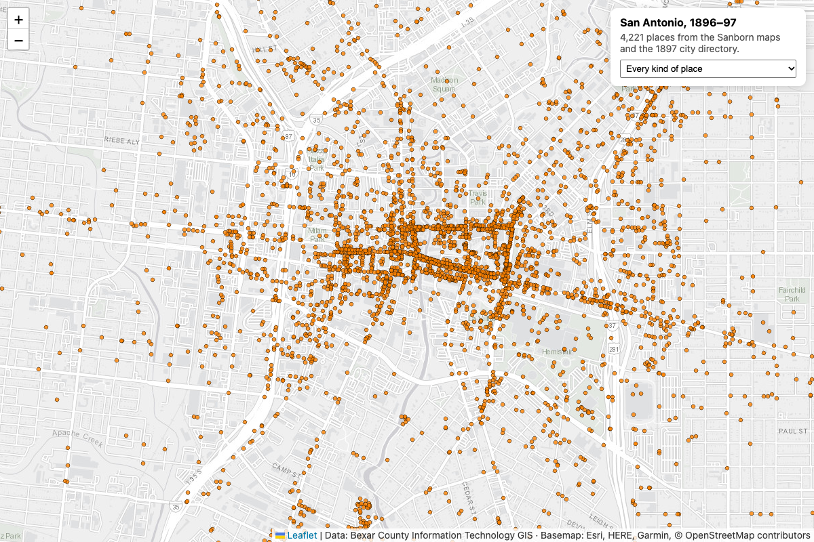

# San Antonio's history: the acequias, and the city of 1896–97

Bexar County has mapped San Antonio's past twice over, and this starter reads both. By default, the **acequias**: the irrigation ditches dug from the river and San Pedro Creek starting in 1718, each with the year it was dug and the year it was abandoned. It asks which ran near a point, then draws all of them on a map with a year slider. With `--1897`, **the city of 1896–97**: about 4,200 places, from saloons and wagon yards to schools and breweries, on one map over today's streets.

```sh
python3 main.py                                        # near Geekdom, Houston and Soledad
python3 main.py --near 29.3621,-98.4794 --meters 300   # near Mission San José
open map.html        # macOS; on Windows `start map.html`, on Linux `xdg-open map.html`
python3 main.py --1897                                 # the 1896–97 city: writes map-1897.html
python3 main.py --json
```

```
Acequias within 400 m of 29.42637, -98.49337:
     76 m  San Pedro Acequia, dug 1718, dry by 1912  (Villa de San Fernando & Presidio de Bexar)
    321 m  Segundo Acequia, dug 1718, dry by 1719  (San Antonio de Valero)
```

The distance filter runs on the County's server (`geometry`, `distance`, `units`); the script only measures how close each ditch came. `map.html` is a self-contained Leaflet page: drag the slider and the ditches flowing in that year turn teal, the ones already dry turn gray.

## About the acequias

The County built this layer, and the others below, for San Antonio's Tricentennial. Its sixteen stretches belong to ten ditches: the Acequia Principal, the San Pedro and the short-lived Segundo from 1718; one for each of the five missions; the Upper Labor from 1776; and Francisco Arocha's private ditch. A ditch dug in sections, like the Alamo's, has a row per section with its own dates.

The same set of layers, all in the County's ArcGIS account, has what the ditches fed:

- **`Labores`**: the irrigated fields of each mission.
- **`300_GrantedLots`**: 348 Spanish land grants, with the grantee, the year and the labor it was in.
- **`Rullman_River`**: the river as these maps draw it, and **`SAMissions`**: the five missions.

## The city of 1896–97



`--1897` pages through the County's historic places layer (the service returns 1,000 at a time), keeps each place's name, category, business type and notes, and writes `places-1897.geojson` and `map-1897.html`, a self-contained page with a filter for each kind of place.

Bexar County Information Technology GIS digitized these from two sources: the **1896 Sanborn fire insurance maps**, drawn building by building for insurers, and the **1897 city directory**. Coordinates are where the County placed each one on a modern map, and its description notes that accuracy can't be guaranteed. The same project produced **City Blocks (1896)** and the directory's **Residence (1897)** and **Employment (1897)** layers, about 21,000 home and 11,000 workplace records with names and occupations.

The directory records real people, and it records race in the language of 1897. Use those layers for history (what the city was, how its neighborhoods and trades were laid out, who built it), not as a way to look up individuals.

## Where to take it

- **Your walk to work.** Which acequias did your route cross, and when did they go dry?
- **Then and now.** Lay the acequias under today's streets and see which ones still follow them.
- **Then and now, 1897.** Put a saloon or wagon yard from `--1897` next to what stands on that lot today, with [`permits-near-you`](../permits-near-you) for what's being built there now.
- **Trades by street.** Group the 1897 Employment layer by street to see which trades clustered where.
- **The grants.** Join `300_GrantedLots` to the ditch that watered each lot, and chart who held land along it by year.

[Follow the water](https://www.devsa.community/localhost#bexar-county), on DEVSA's site, is built from these layers.

## Source

Bexar County Tricentennial layers, feature service `services1.arcgis.com/8onVmslF2KXErTHT/arcgis/rest/services/RullmanAcequia/FeatureServer/0`, and [Historic Points of Interest (1896–97)](https://gis-bexar.opendata.arcgis.com), `services1.arcgis.com/8onVmslF2KXErTHT/arcgis/rest/services/Historic_POI/FeatureServer/0`. Basemap tiles by Esri.

Data: Bexar County Information Technology GIS
