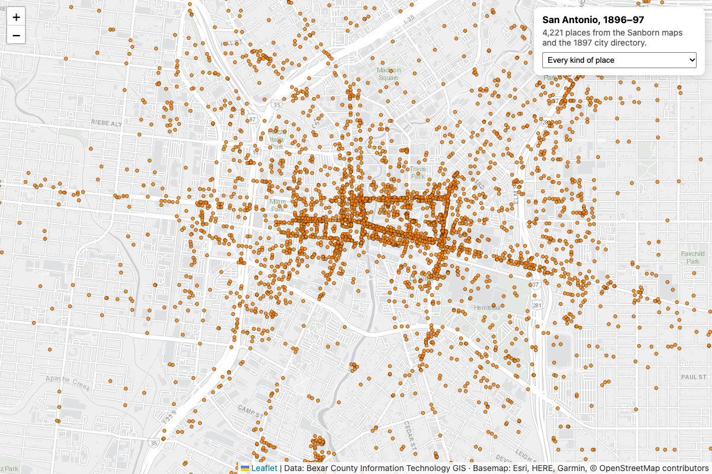

# San Antonio, 1896–97

About 4,200 places in San Antonio as it was in 1896–97 — hospitals, saloons, schools, wagon yards, churches, breweries, hotels — on one map, over today's streets.



```sh
python3 main.py
open map.html        # macOS; on Windows `start map.html`, on Linux `xdg-open map.html`
```

The script pages through the County's historic places layer (the service returns 1,000 at a time), keeps the name, category, business type and notes, and writes two files: `places-1897.geojson`, and `map.html`, a self-contained Leaflet page. The page works anywhere you can host a single file, including GitHub Pages.

## About the data

Bexar County Information Technology GIS digitized these from two sources: the **1896 Sanborn fire insurance maps**, drawn building by building for insurers, and the **1897 city directory**. Coordinates are where the County placed each one on a modern map, and its description notes that accuracy can't be guaranteed.

The same project produced three more layers, all on the [County portal](https://gis-bexar.opendata.arcgis.com):

- **City Blocks (1896)**: block outlines from the Sanborn maps.
- **Residence (1897)** and **Employment (1897)**: about 21,000 home and 11,000 workplace records from the directory, with names and occupations.

The directory records real people, and it records race in the language of 1897. Use those two layers for history — what the city was, how its neighborhoods and trades were laid out, who built it — and not as a way to look up individuals.

## Where to take it

- **Then and now.** Put a 1897 saloon or wagon yard next to what stands on that lot today.
- **Trades by street.** Group the Employment layer by street to see which trades clustered where.
- **A walking tour** of one downtown block, with the Sanborn block outline from the City Blocks layer.

## Source

[Bexar County Historic Points of Interest (1896–97)](https://gis-bexar.opendata.arcgis.com), feature service `services1.arcgis.com/8onVmslF2KXErTHT/arcgis/rest/services/Historic_POI/FeatureServer/0`. Basemap tiles by Esri.

Data: Bexar County Information Technology GIS
